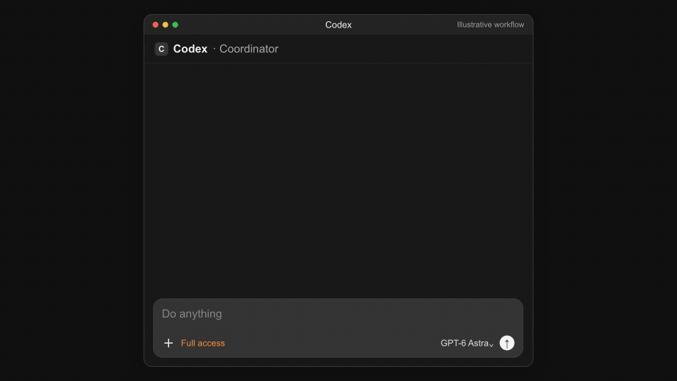

# pragmatic-orchestration

`pragmatic-orchestration` is a field-tested system for orchestrating coding agents across vendors. Its cross-agent skill turns any skill-capable harness into an orchestrator: Codex, Claude Code, Cursor, OpenCode, and others can call external agents through the `porch` CLI.

[](https://github.com/CodeAlive-AI/pragmatic-orchestration/raw/refs/heads/main/assets/guest-checkout-steer.mp4)

*Click the demo to watch the MP4. Illustrative workflow: Codex spots a deviation and redirects Devin while the task is running.*

In field use, frontier models such as Astra and Fable cover roughly 2–10× more work with practically no loss of quality when they orchestrate and cheaper executors implement. The best fit is autonomous work lasting hours or days, producing tens to hundreds of thousands of lines of code.

The repo ships three skills in the Agent Skills layout: `pragmatic-orchestration`, `coordinator-mode` and `remote-agents`. `porch` provides five modes:

- **review** — independent opinions or multi-depth code review from several model families at once (read-only).
- **delegate** — hand a task to one exact agent: steerable by default, detachable, with `wait` / `watch` / `events` / `list` to supervise long-running work (full-access runtime).
- **sessions** — search and navigate local coding-agent session histories. Its
  format research draws on [Agent Sessions](https://github.com/jazzyalex/agent-sessions);
  see the [supported formats and evidence](skills/pragmatic-orchestration/references/session-compatibility.md).
- **media** — transcribe audio/video (Antigravity) and generate, edit, combine, animate (GIF) or describe images (Codex, Antigravity; description also Claude Code), read-only, with results collected into your output directory.
- **quota** — read remaining Codex / Grok subscription quota.

Supported worker harnesses: Codex CLI, Claude Code, OpenCode, Grok Build, Devin CLI, Antigravity CLI (`agy`), and Gemini CLI (review only).

The repo also ships **`remote-agents`**: a companion skill for operating dedicated remote Linux/Windows hosts that run these agents — secure VM/OS provisioning, SSH-over-SSM access with no public ingress, the WireGuard/SMB work bridge, `porch` on the remote host, a headless Windows desktop, bounded visual QA, durable worker daemons, and Codex Remote threads. See [skills/remote-agents/SKILL.md](skills/remote-agents/SKILL.md).

Full documentation: [skills/pragmatic-orchestration/README.md](skills/pragmatic-orchestration/README.md) and [SKILL.md](skills/pragmatic-orchestration/SKILL.md).

## Optional live UI

For an optional live view of existing delegates, see [Porch UI](skills/pragmatic-orchestration/ui/README.md).
After its one-time build, `porch ui --desktop` opens an Electron window with run
discovery, filters, streaming output, and saved final answers. Closing it leaves
agents running. `porch ui` instead prints a local URL without opening a browser.

## Recommended combinations

These combinations come from field use.

| Priority | Orchestrator → executor | Tradeoff |
|---|---|---|
| Best quality | Astra Light or Fable Low → Sol low or Opus low | Very high quality. Quotas still get consumed, but several times slower than using frontier models end-to-end. Opus low lasts longest as executor. |
| Quality/quota balance | Sol medium → Devin SWE 2.0, with Astra as planner | Devin SWE 2.0 is free on the $20 subscription until October 15, 2026. |

For planning, use Astra medium+ or Fable, guided by the `code-that-fits-in-your-head` skill (`~/.claude/skills/code-that-fits-in-your-head/SKILL.md`). Having the orchestrator and planner consult each other works well.

## Coordinator Mode

`coordinator-mode` turns a session into a long-lived coordinator: a frontier model that plans, derives invariants, designs verification, hands implementation to cheaper executors and accepts their results on evidence. It is built to stay in that role for days or weeks.

- **Two roles.** The coordinator owns the engineering quality of the codebase; an executor owns one assignment. `porch delegate` tells every worker so, which keeps "you own this codebase" passages in `AGENTS.md` from widening a worker's scope.
- **Judgment, not prohibitions.** Delegation is the default because of cost and focus. Nothing is forbidden: the coordinator steps in itself when that is plainly better for the project.
- **A journal.** Goal, decisions, verification plan, workers and the next action live in one Markdown file outside the project, or inside the plan file when you ask for that.
- **Compaction-proof.** After every context compaction the coordinator rereads the skill and the journal. An optional hook puts the reminder back automatically.
- **Verification by design.** The coordinator decides which scenarios are checked, at which level (unit, integration, contract, end-to-end) and what counts as evidence. Executors write and run the tests.

Turn it on explicitly: `/coordinator-mode` in Claude Code, `$coordinator-mode` in Codex. See [skills/coordinator-mode/SKILL.md](skills/coordinator-mode/SKILL.md).

## Delegation discipline

[references/delegate.md](skills/pragmatic-orchestration/references/delegate.md) collects the practices that address common subagent delegation failures:

- Write a precise task contract: purpose, exact working root, scope, compatibility constraints, anticipated pitfalls, acceptance criteria, and required checks.
- Every delegated worker is an executor. `porch delegate` prefixes each new task with a short contract: the assignment sets the scope, out-of-scope findings go into the report, and checks are not weakened.
- Check every worker within its first minute. Inspect actual actions and findings, then adapt supervision to risk and progress; 5–15 minutes is the suggested follow-up interval.
- Require a deviation journal when delegating to a less capable model. Record unexpected findings, evidence, actions, and unresolved risks. Read-only workers return it in their final answer.
- Do not retry blindly. Inspect events and partial work, send only new guidance, and confirm a writer has stopped before assigning overlapping work to a replacement.
- The parent owns verification. Inspect the diff and surrounding code, verify the checks, then reconcile the entire deviation journal. A worker's summary or successful exit is not enough.

## Orchestration tips

- For long work, turn on `coordinator-mode`: the orchestrator keeps its plan and progress in a journal, so context compaction cannot erase them.
- In Codex, use a cron reminder every 15–30 minutes. `goal` consumes quota quickly.
- Periodically ask whether enough work is running in parallel. Put that question in the cron description or install a hook to prompt it.
- With Claude Code as orchestrator, cap context at about 300k tokens with `/autocompact 300000` to limit context rot. Keep updating the progress file.
- Use Jujutsu (`jj`) for parallel work. Its flexible conflict, rebase, and commit-moving semantics let conflicts accumulate for the orchestrator to resolve later in one pass.
- Regularly have a strong model analyze session transcripts to assess subagent effectiveness and the orchestration flow.
- If workers spend hours without progress and the orchestrator cannot redirect them, stop all work and intervene. Continuing the same loop makes it worse.

## Install

```bash
npx skills add CodeAlive-AI/pragmatic-orchestration@pragmatic-orchestration
npx skills add CodeAlive-AI/pragmatic-orchestration@coordinator-mode
claude plugin marketplace add CodeAlive-AI/pragmatic-orchestration && claude plugin install pragmatic-orchestration@pragmatic-orchestration
```

## Platform support

The system is fully field-tested on macOS. Linux and Windows 11 support is experimental: both are covered by CI but have less field use. CI runs on Ubuntu, macOS, and Windows.

Windows 11 requires Git Bash/MSYS2 and native Python 3.11+. `porch.cmd` runs `sessions` and `quota` natively; `review` and `delegate` run from Git Bash.

## License

MIT — see [LICENSE](LICENSE).
